# CalmRoute — Sensory-Friendly Metro Navigation

**CalmRoute** is a sensory-friendly mobile metro navigation and step-free wayfinding application designed to help commuters travel with predictable comfort, lower sensory load, and verified step-free access.

---

## Live Deployment & Figma Prototype Links

- **Deployment Link**: [**CalmRoute Live Application (Vercel)**](https://ui-ux-assignment-seven.vercel.app/) — https://ui-ux-assignment-seven.vercel.app/
- **Figma Prototype & Design File**: [**CalmRoute — Sensory-Friendly Metro Navigation (Figma)**](https://www.figma.com/design/qlrTo4EXa2jxTkgu6WlE9O/CalmRoute-%E2%80%94-Sensory-Friendly-Metro-Navigation?node-id=0-1&p=f&t=pszJuGJ57FxuV4sK-0)
- **Direct Figma URL**: https://www.figma.com/design/qlrTo4EXa2jxTkgu6WlE9O/CalmRoute-%E2%80%94-Sensory-Friendly-Metro-Navigation?node-id=0-1&p=f&t=pszJuGJ57FxuV4sK-0

---

## Key Features & Coordinated Mobile Flow

1. **Onboarding & Sensory Personalization**
   - **Welcome Screen**: Visual **83/100** radial comfort gauge, `Riverside → Green Park → Central` route schematic, and quick entry into comfort setup.
   - **Comfort Setup (Step 1 of 2)**: Toggle *Quieter routes*, *Less crowded stations*, *Fewer transfers*, *Less walking*, *Reduced motion*, and *Visual instructions*.
   - **Accessibility (Step 2 of 2)**: Configure *Step-free required*, *Prefer lifts*, *Avoid escalators*, *Extra transfer time*, *Larger text*, *Voice guidance*, and *Visual notifications*.

2. **Route Discovery & Transparent Comfort Scoring**
   - **Home Dashboard**: Quick *From / To* route search, active sensory comfort summary, saved journeys, and one-tap access to the *Travel checklist* and *Station help*.
   - **Station Search & Station Details**: Select stations across the Blue, Green, and Purple lines and inspect platform wayfinding diagrams and verified lift/step-free access details.
   - **Compare Routes & Route Filters**: Compare the *Fastest route* (`24 min · Comfort 47/100`), *Best match* (`31 min · Comfort 83/100`), and *Step-free alternative* (`36 min · Comfort 71/100`).
   - **Comfort Score Breakdown**: Inspect the 6 weighted factors (*Crowd levels*, *Noise levels*, *Transfers*, *Navigation*, *Walking*, and *Reliability*).

3. **Pre-Trip Wayfinding & Live Journey Support**
   - **Route Detail & 5-Step Journey Preview**: Interactive architectural SVG diagrams for station entrances, concourse lifts, carriage crowd density, flat interchanges, and street exits.
   - **Your Journey (Live Navigation)**: Real-time step card, 4-stage progress tracker, sensory crowd/noise bar, and repeatable voice instructions.
   - **Calm Disruption Recovery**: Low-stress *Disruption alert* (`Blue Line +8 min delay`) and *Alternative routes* comparison (`Alternative A · 33 min · Comfort fit 79/100`).
   - **Station Support, Privacy & Audio**: *Travel checklist*, *Quiet places & help* concourse map, *Share journey* with trusted contacts, *Saved journeys*, *Settings*, and *Voice guidance* with live audio waveform indicators.

---

## Application Screenshots (`/png`)

All mobile screen captures are stored in the [`/png`](./png) directory:

| Welcome Screen | Home Screen | Station Search | Compare Routes |
| :---: | :---: | :---: | :---: |
| 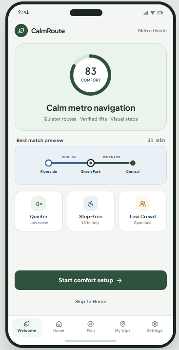 | 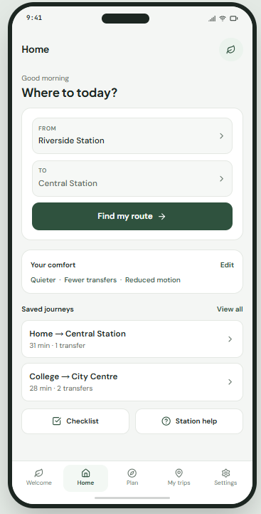 | 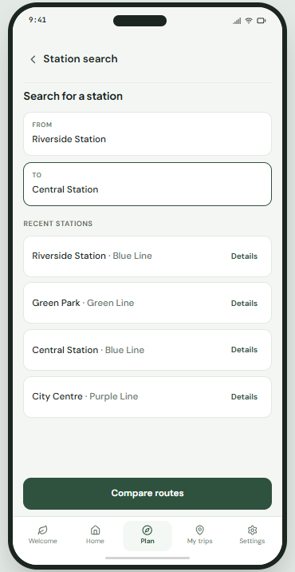 | 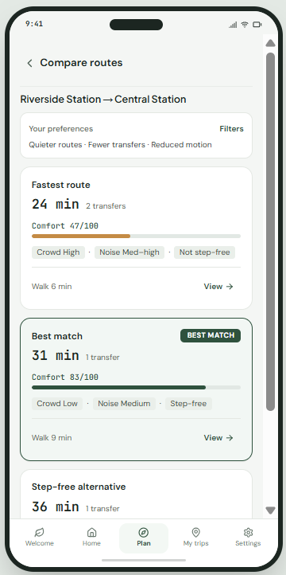 |

| Comfort Setup | Accessibility | Saved Journeys | Settings |
| :---: | :---: | :---: | :---: |
| 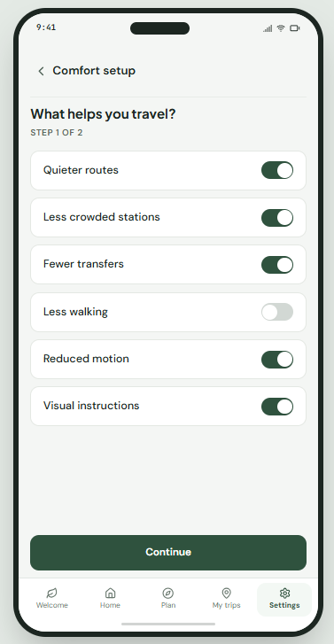 | 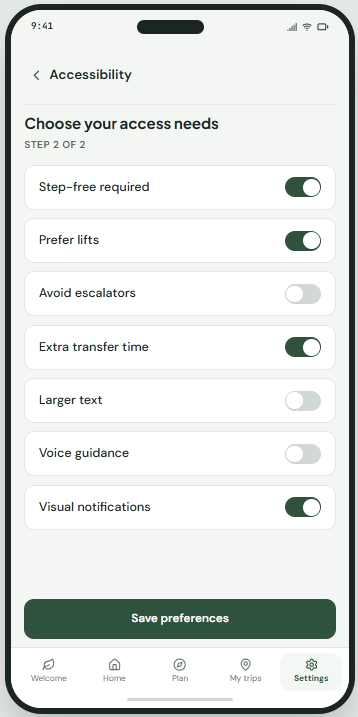 | 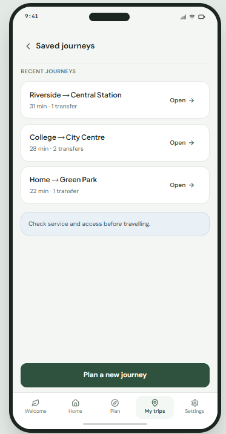 | 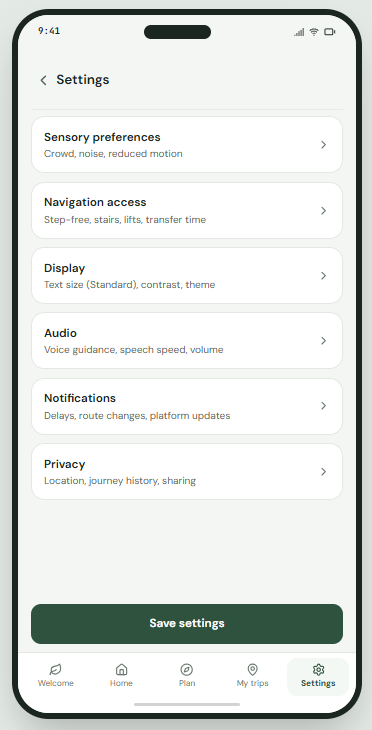 |

| Settings (Larger Text) | Voice Guidance | Share Journey |
| :---: | :---: | :---: |
| 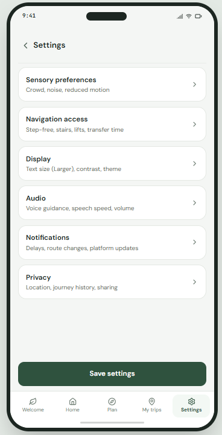 | 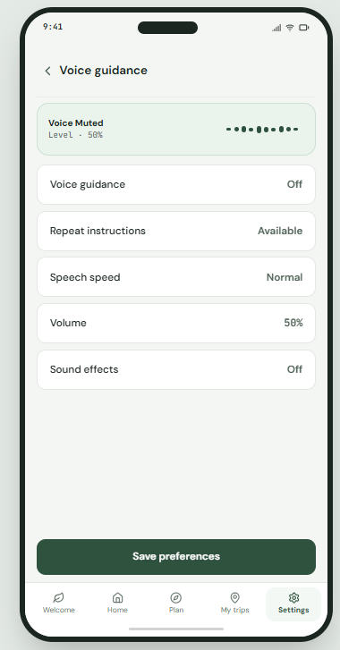 | 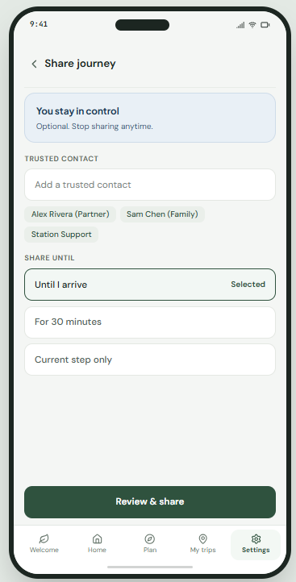 |

---

## Running Locally

```bash
# Install dependencies
npm install

# Start development server on port 3000
npm run dev

# Run unit tests
npx --yes tsx --test src/utils/calmRouteLogic.test.ts

# Typecheck and build for production
npm run lint
npm run build
```
